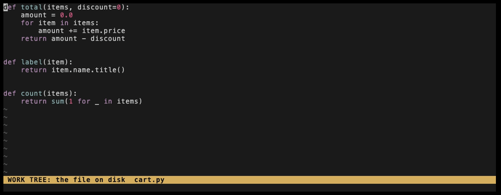
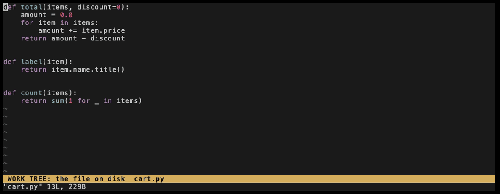

# fugitive-extras

Additions to [vim-fugitive](https://github.com/tpope/vim-fugitive): review a
branch the way a pull request shows it, stage hunks in a vertical diff, and
leave review comments saved per branch.

**Vim or Neovim:** tested on Vim 9.1 and newer. It's plain Vimscript, so it may
work on Neovim, but that's untested.

## Install

```vim
Plug 'tpope/vim-fugitive'
Plug 'vimoured/fugitive-extras'
```

That gives you the diffs. Optional, each for the commands it adds:

| Also needs | Adds |
| --- | --- |
| [vim-lists](https://github.com/vimoured/vim-lists) | `:Compares`, `:BranchCommits` |
| [vim-place](https://github.com/vimoured/vim-place) | `:Comment`, `:Comments`, `:CommentsClear` |
| vim-place + [vim-draft](https://github.com/vimoured/vim-draft) | `:CommentDraft` |
| vim-place + [vim-review](https://github.com/vimoured/vim-review) | `:CommentsSave`, `:CommentsLoad` |

## Use

Three words come up in every diff:

- **Work tree:** your files on disk, as you've edited them.
- **Index:** what's staged, so what the next commit would contain.
- **Merge-base:** the commit where your branch left the default branch. Comparing
  against it shows what your branch changes, and leaves out what the default
  branch has gained since.

The older side is on the left, and the cursor starts on the right. In the
GIFs, the status lines name each side. They come from the demo's config, not
from the plugin.

### `:DiffThis`

What you haven't staged in this file: the index against the work tree.



The cursor stays on your file. On a hunk, `dp` stages it.

### `:DiffThis!`

What your branch changes in this file: the merge-base against the work tree,
uncommitted changes included.



### `:DiffCommit [rev]`

What one commit changed in this file: its parent against the commit. The default
is `HEAD`.


### `:DiffCommit! [rev]`

The same parent against the work tree, so it adds everything that came after the
commit.


### `:BranchDiff [branch]`

Review a branch the way a pull request shows it: one tab per file its commits
change, each against the merge-base. The default is the current branch, and
naming one, such as `origin/feature`, reviews it without checking it out.


### `:BranchDiff!`

The same for the current branch, with the work tree on the right, so uncommitted
changes are included.


### Other commands

| Command | What it does |
| --- | --- |
| `:DiffRefresh` | Redo the comparison in this tab. |
| `:DiffClose [name]` | Close a comparison's tabs. |
| `:Compares` | List the comparisons `:BranchDiff` opened. |
| `:BranchCommits [branch] [args]` | List the commits the default branch lacks. |

### Review comments

Comments go in a quickfix list titled `Review`:

| Command | What it does |
| --- | --- |
| `:[range]Comment [text]` | Comment on a line or range. |
| `:[range]CommentDraft [text]` | Write the comment in a draft. |
| `:Comments` | Open the list; `c` edits the comment on the line. |
| `:CommentsSave [file]` | Save the comments, per branch without `file`. |
| `:CommentsLoad [file]` | Load comments, moved to where their lines are now. |
| `:CommentsClear` | Empty the list; saves are kept. |

Every command except `:Comments`, `:CommentsSave`, `:CommentsLoad` and
`:CommentsClear` has a `<Plug>` mapping to bind, for example:

```vim
nmap <leader>cd <Plug>(fugitive-extras-diff-main)
nmap <leader>cr <Plug>(fugitive-extras-diff-refresh)
nmap <leader>cl <Plug>(fugitive-extras-branch-commits)
nmap <leader>cc <Plug>(fugitive-extras-comment)
xmap <leader>cc <Plug>(fugitive-extras-comment)
```

## Tests

The specs in [vim-suite](https://github.com/vimoured/vim-suite) define what it
does: `test/fugitive-extras.vim`.

`docs/demo/record.sh` records the GIFs, and needs [VHS](https://github.com/charmbracelet/vhs).
